### Hi there!

I'm Jacob, a full-stack developer from Cebu, Philippines. Lately I've been making [Glim](https://glim.jacobbalane.com), an open-source desktop app that shows what Claude Code and Codex are up to in a tiny island at the top of your screen. I also built the new [React Cebu](https://react-cebu-2026-preview.netlify.app/) community website. More of my work lives at [jacobbalane.com](https://jacobbalane.com).

<picture>
  <source media="(prefers-color-scheme: dark)" srcset="assets/terminal-dark-d08f023b39.svg">
  
</picture>
